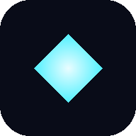
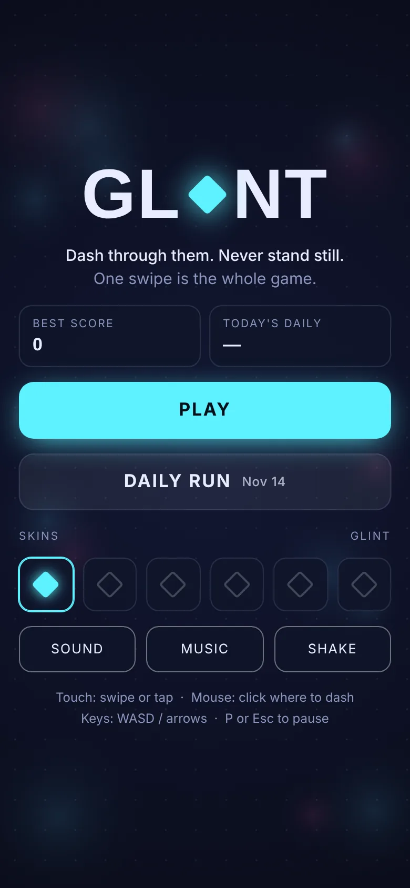
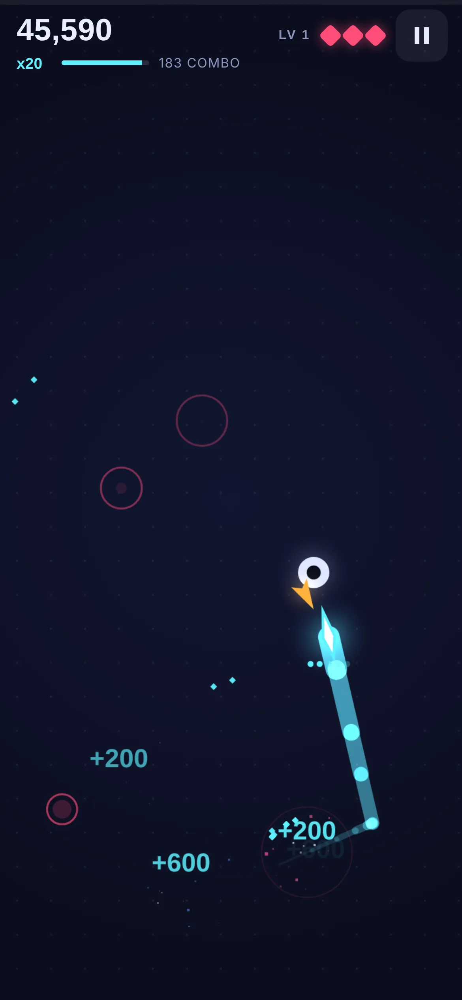
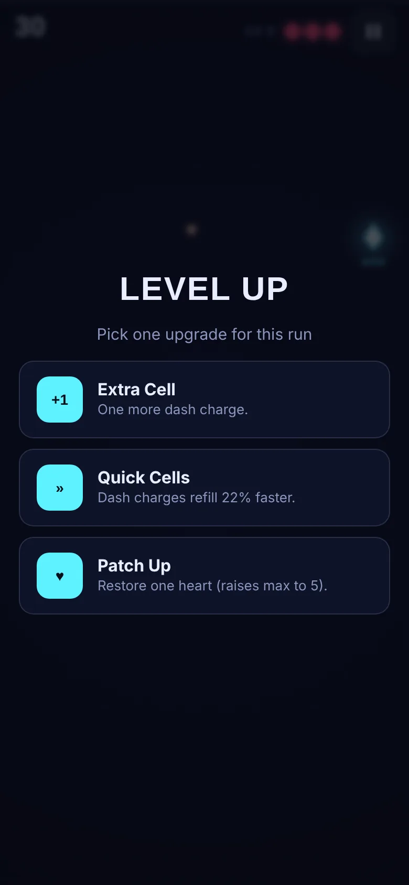
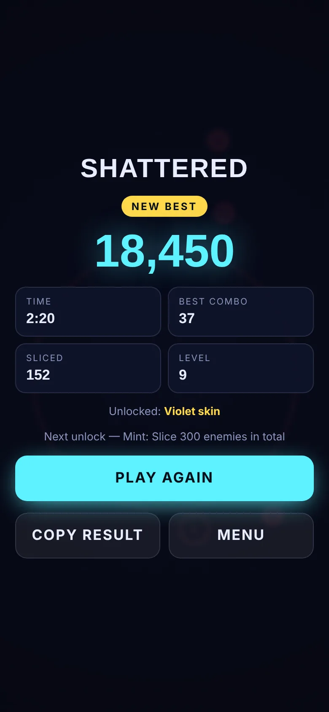
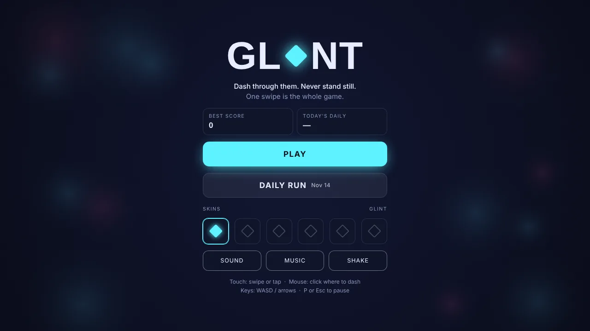
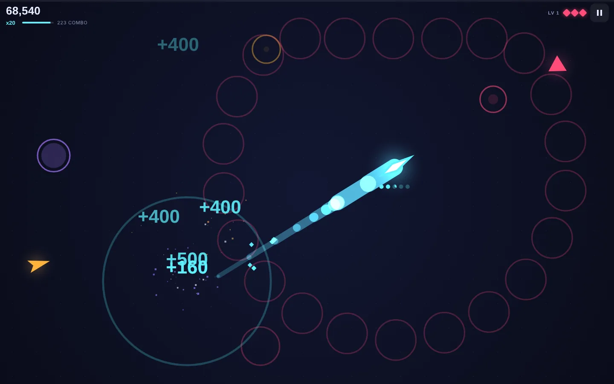
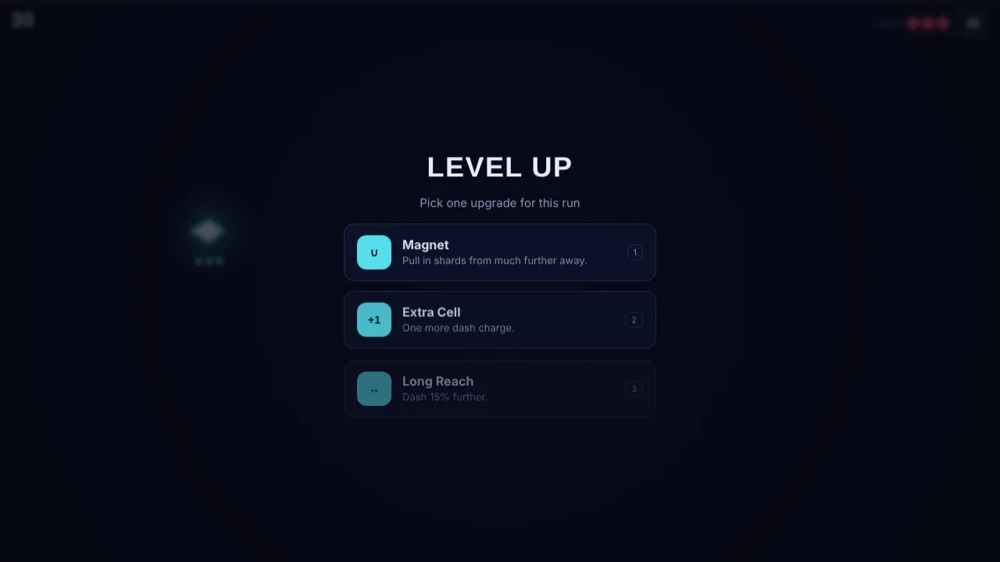
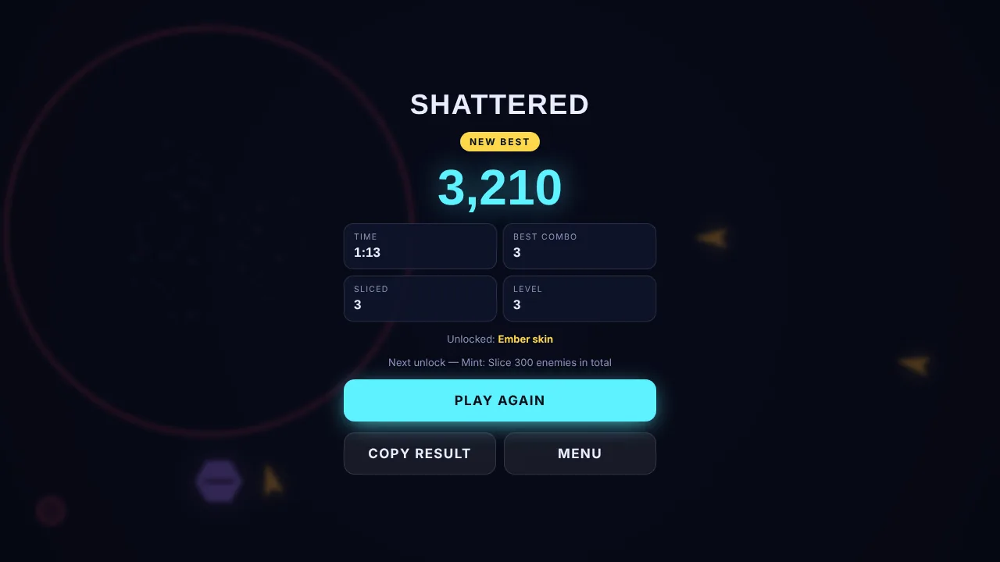

<h1> GLINT</h1>

### A one-swipe dash arcade game. Zero installs, zero ads, zero mercy.

**You only move by dashing. Dash through enemies to slice them. Stand still and you die.**

   

---

## 🎮 What is this?

GLINT is a browser-based arcade game built around one idea: **the dash is the only verb.**

There's no "move" button. You pick a direction, dash, and anything in your path gets sliced. Enemies drop shards that level you up, combos stack a score multiplier up to **x20**, and the moment you hesitate, something closes in. It's built to be learned in 10 seconds and chased for 10 minutes.

No login. No download. No ads. No energy timers. Just open it and go.

### 📱 Mobile

<table>
<tr>
<td width="25%">
Start screen
</td>
<td width="25%">
In a run
</td>
<td width="25%">
Level-up pick
</td>
<td width="25%">
Run summary
</td>
</tr>
</table>

### 🖥️ Web / Desktop

<table>
<tr>
<td width="50%">
Start screen
</td>
<td width="50%">
Mid-combo chaos
</td>
</tr>
<tr>
<td width="50%">
Level-up pick
</td>
<td width="50%">
Run summary
</td>
</tr>
</table>

---

## 🕹️ Controls

| Device             | Input                                             |
| ------------------ | ------------------------------------------------- |
| 📱 Touch           | Swipe a direction, or tap where you want to dash  |
| 🖱️ Mouse           | Click where you want to dash                      |
| ⌨️ Keyboard        | `WASD` / arrow keys (hold two keys for diagonals) |
| ⏸️ Pause           | `P`, `Esc`, or the pause button                   |
| ▶️ Start / restart | `Space` or `Enter`                                |
| ⬆️ Level-up pick   | Click a card, or press `1` / `2` / `3`            |
| 🔇 Mute            | `M`                                               |

---

## ⚙️ How it works

- 🔋 You hold **3 dash charges** that refill over time - every slice refunds one, so chaining kills keeps you moving.
- 🔥 Slicing builds a **combo**; your multiplier climbs every 4 slices, up to **x20**.
- 💥 Slice multiple enemies in a _single_ dash for a big bonus.
- 💎 Enemies drop shards - collect them to level up and pick **1 of 3 upgrades** for that run.
- ⚠️ **Spiked enemies** (red, spikes extended) will hurt _you_ if you dash into them - wait for them to retract.
- 🌊 A **swarm** arrives every 30 seconds, and both spawn rate and enemy speed climb the longer you survive.
- 📅 **Daily Run** - a date-seeded run so everyone gets the same opening layout each day. Beat it, then share a screenshot of your result to flex.
- 🎨 **5 unlockable skins**, earned through lifetime milestones (total kills, best combo, survival time, daily runs completed).

---

## 🧱 Built with

- **Canvas 2D** + plain **JavaScript** - no framework, no bundler
- **Web Audio API** - all sound effects and music are synthesized in-browser, no audio files
- **`localStorage`** - high score, stats, settings, and skin unlocks persist locally (`glint.save.v1`)
- **Self-hosted fonts** (Unbounded, Space Grotesk, SIL Open Font License), preloaded and cached for offline play

One file. No `npm install`. No dependencies to go stale.

---

## ⚠️ Known limitations

- 🏆 Scores live in your browser only - no online leaderboard.
- 📅 Daily runs share a seed but aren't frame-identical between players.
- 🔧 `window.__glint` exposes game state for testing purposes (lets anyone edit score via devtools) - strip it out before adding any shared/competitive leaderboard.
